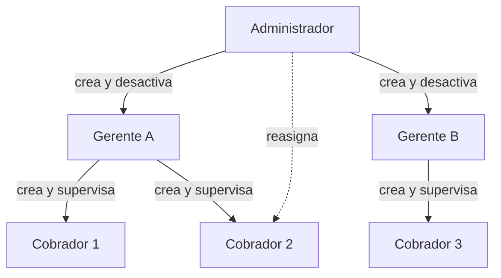
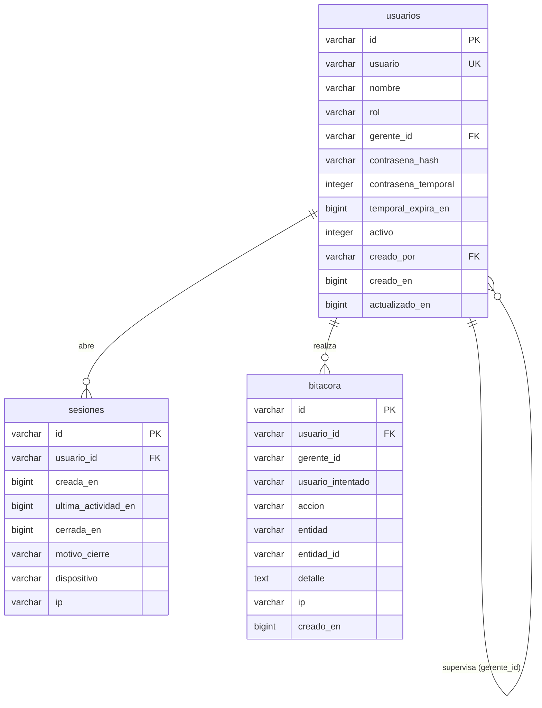
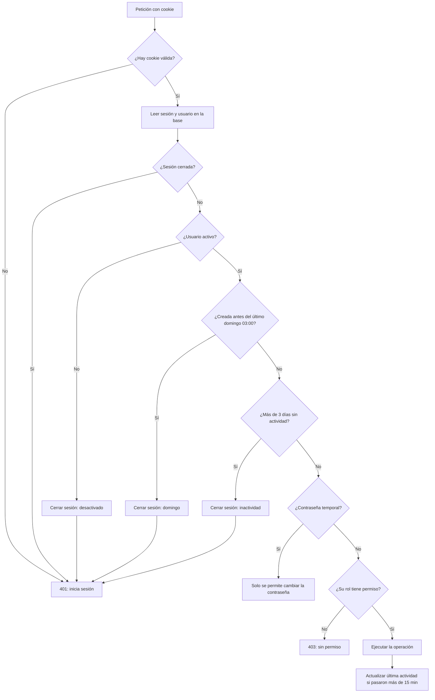
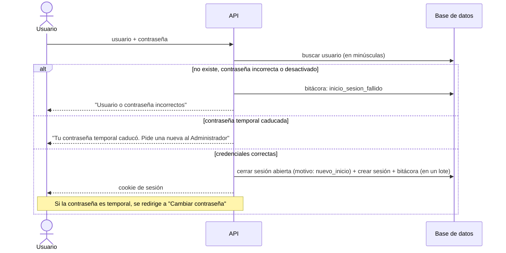
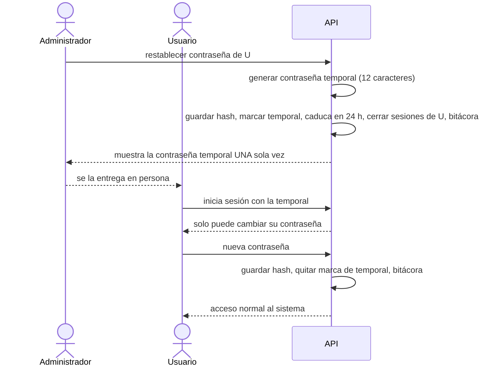
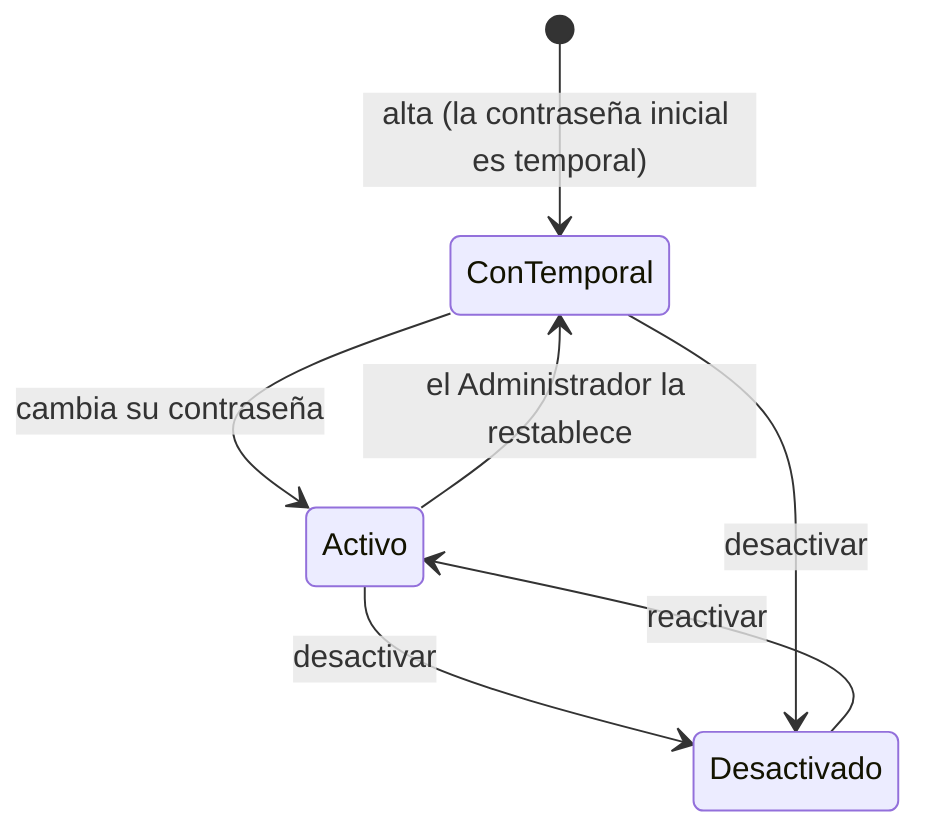

# 1.2 Diseño de usuarios y roles

**Incremento 1:** Gestión de usuarios, roles y seguridad
**Responsable:** Martínez Mendoza Karlo Daniel
**Basado en:** [1.1 Análisis de requisitos de acceso](1.1-analisis-requisitos-acceso.md)

## 1. Jerarquía de roles



- El **ámbito** de un Gerente son sus Cobradores: solo ve y administra a ellos (RF28, RF32).
- El Administrador ve a todos los usuarios, pero no opera la parte financiera.

## 2. Matriz de permisos

| Acción | Administrador | Gerente | Cobrador |
| --- | :---: | :---: | :---: |
| Crear Gerente | ✅ | ❌ | ❌ |
| Editar, activar o desactivar Gerente | ✅ | ❌ | ❌ |
| Crear Cobrador | ✅ (elige el Gerente) | ✅ (queda como su Gerente) | ❌ |
| Editar, activar o desactivar Cobrador | ✅ | ✅ solo los suyos | ❌ |
| Reasignar Cobrador a otro Gerente | ✅ | ❌ | ❌ |
| Restablecer contraseña de otro usuario | ✅ | ❌ | ❌ |
| Cambiar su propia contraseña | ✅ | ✅ | ✅ |
| Consultar los datos de su cuenta ("Mi cuenta") | ✅ | ✅ | ✅ |
| Corregir su propio nombre | ✅ | ❌ (lo hace el Administrador) | ❌ (lo hace su Gerente) |
| Consultar usuarios | ✅ todos | ✅ solo sus Cobradores | ❌ |
| Consultar bitácora | ✅ toda | ✅ la suya y la de sus Cobradores | ❌ |

La API valida cada permiso en el servidor. La interfaz solo oculta lo que el usuario no puede hacer
(RNF16), pero nunca es la única protección.

## 3. Modelo de datos



### Convenciones

| Dato | Tipo | Motivo |
| --- | --- | --- |
| Identificadores | `VARCHAR(36)` con UUID generado en la aplicación | Igual en SQLite y PostgreSQL; no depende de `AUTOINCREMENT`. |
| Fechas y horas | `BIGINT` en milisegundos (UTC) | Se comparan como números; sin funciones de fecha propias de cada gestor. |
| Sí / no | `INTEGER` 0 o 1 con `CHECK` | SQLite no tiene `BOOLEAN`. |
| Listas cerradas (rol, motivo) | `VARCHAR` con `CHECK (... IN (...))` | Evita valores inválidos desde la base de datos. |

### 3.1 Tabla `usuarios`

```sql
CREATE TABLE usuarios (
  id                   VARCHAR(36)  PRIMARY KEY,
  usuario              VARCHAR(30)  NOT NULL UNIQUE,      -- siempre en minúsculas (RN-01)
  nombre               VARCHAR(150) NOT NULL,
  rol                  VARCHAR(15)  NOT NULL
                       CHECK (rol IN ('administrador', 'gerente', 'cobrador')),
  gerente_id           VARCHAR(36),
  contrasena_hash      VARCHAR(255) NOT NULL,
  contrasena_temporal  INTEGER      NOT NULL DEFAULT 0 CHECK (contrasena_temporal IN (0, 1)),
  temporal_expira_en   BIGINT,
  activo               INTEGER      NOT NULL DEFAULT 1 CHECK (activo IN (0, 1)),
  creado_por           VARCHAR(36),
  creado_en            BIGINT       NOT NULL,
  actualizado_en       BIGINT       NOT NULL,
  -- RN-02: solo el Cobrador tiene Gerente
  CHECK ((rol = 'cobrador' AND gerente_id IS NOT NULL) OR (rol <> 'cobrador' AND gerente_id IS NULL)),
  FOREIGN KEY (gerente_id) REFERENCES usuarios (id),
  FOREIGN KEY (creado_por) REFERENCES usuarios (id)
);

CREATE INDEX idx_usuarios_gerente ON usuarios (gerente_id);
```

### 3.2 Tabla `sesiones`

```sql
CREATE TABLE sesiones (
  id                   VARCHAR(36)  PRIMARY KEY,
  usuario_id           VARCHAR(36)  NOT NULL,
  creada_en            BIGINT       NOT NULL,
  ultima_actividad_en  BIGINT       NOT NULL,
  cerrada_en           BIGINT,
  motivo_cierre        VARCHAR(20)
                       CHECK (motivo_cierre IN ('salida', 'nuevo_inicio', 'domingo', 'inactividad',
                                                'desactivado', 'restablecimiento', 'cambio_contrasena')),
  dispositivo          VARCHAR(300),
  ip                   VARCHAR(45),
  FOREIGN KEY (usuario_id) REFERENCES usuarios (id)
);

-- RF05 / RN-16: la base de datos impide dos sesiones abiertas de la misma cuenta.
CREATE UNIQUE INDEX idx_sesiones_una_abierta ON sesiones (usuario_id) WHERE cerrada_en IS NULL;
```

> El índice único parcial (`WHERE cerrada_en IS NULL`) funciona en SQLite y PostgreSQL. Así la regla
> de sesión única no depende solo del código: aunque hubiera un error, la base de datos no acepta
> una segunda sesión abierta.

### 3.3 Tabla `bitacora`

```sql
CREATE TABLE bitacora (
  id                 VARCHAR(36)  PRIMARY KEY,
  usuario_id         VARCHAR(36),               -- NULL en un intento fallido de usuario inexistente
  gerente_id         VARCHAR(36),               -- Gerente del usuario al momento del evento
  usuario_intentado  VARCHAR(30),               -- solo en intentos fallidos
  accion             VARCHAR(40)  NOT NULL,
  entidad            VARCHAR(30),               -- p. ej. 'usuario'
  entidad_id         VARCHAR(36),
  detalle            TEXT,                      -- JSON con los datos relevantes
  ip                 VARCHAR(45),
  creado_en          BIGINT       NOT NULL,
  FOREIGN KEY (usuario_id) REFERENCES usuarios (id)
);

CREATE INDEX idx_bitacora_fecha   ON bitacora (creado_en);
CREATE INDEX idx_bitacora_usuario ON bitacora (usuario_id, creado_en);
CREATE INDEX idx_bitacora_gerente ON bitacora (gerente_id, creado_en);
```

> **¿Por qué `gerente_id` en la bitácora?** Si un Cobrador se reasigna, su actividad anterior debe
> seguir visible para el Gerente que lo supervisaba en ese momento, no para el nuevo. Guardar el
> Gerente al registrar el evento conserva esa trazabilidad (RNF29).

La bitácora solo recibe inserciones: ningún registro se modifica ni se elimina.

**Acciones registradas:** `inicio_sesion`, `inicio_sesion_fallido`, `cierre_sesion`, `usuario_creado`,
`usuario_modificado`, `usuario_activado`, `usuario_desactivado`, `cobrador_reasignado`,
`contrasena_restablecida`, `contrasena_cambiada`.

## 4. Validación de la sesión en cada petición

La cookie de sesión va cifrada y marcada como `HttpOnly`, `Secure` y `SameSite=Lax`. Solo contiene el
identificador de la sesión y los datos básicos del usuario. En cada petición protegida se ejecuta:



**Cálculo del último cierre dominical:** como México usa UTC−6 todo el año, el domingo a las 03:00
en México equivale al domingo a las 09:00 UTC. La sesión es válida solo si se creó después del
domingo 09:00 UTC más reciente.

**Costo en D1:** una lectura por petición (sesión y usuario juntos) y, como máximo, una escritura
cada 15 minutos por usuario activo.

## 5. Inicio de sesión



- El mensaje de error es el mismo cuando el usuario no existe y cuando la contraseña es incorrecta,
  para no revelar qué usuarios existen.
- Cerrar la sesión anterior, abrir la nueva y registrar la bitácora se ejecutan juntos: o se aplican
  todos o ninguno (RF110).

## 6. Recuperación de contraseña



## 7. Estados del usuario



Al dar de alta a un usuario, quien lo crea recibe una contraseña temporal para entregársela; el
usuario la cambia en su primer inicio de sesión. Así nadie más conoce la contraseña definitiva.

## 8. API prevista

| Método | Ruta | Quién | Descripción |
| --- | --- | --- | --- |
| POST | `/api/auth/iniciar-sesion` | Público | Inicio de sesión |
| POST | `/api/auth/cerrar-sesion` | Con sesión | Cierra la sesión actual |
| POST | `/api/auth/cambiar-contrasena` | Con sesión | Cambia la contraseña propia |
| GET | `/api/mi-cuenta` | Con sesión | Datos de la cuenta propia (consulta) |
| PATCH | `/api/mi-cuenta` | Admin | Corrige su propio nombre |
| GET | `/api/usuarios` | Admin, Gerente | Lista filtrada por ámbito |
| POST | `/api/usuarios` | Admin, Gerente | Crea Gerente o Cobrador según permisos |
| GET | `/api/usuarios/:id` | Admin, Gerente | Detalle |
| PATCH | `/api/usuarios/:id` | Admin, Gerente | Edita nombre o nombre de usuario |
| POST | `/api/usuarios/:id/activar` | Admin, Gerente | Reactiva |
| POST | `/api/usuarios/:id/desactivar` | Admin, Gerente | Desactiva y cierra sus sesiones |
| POST | `/api/usuarios/:id/reasignar` | Admin | Cambia el Gerente de un Cobrador |
| POST | `/api/usuarios/:id/restablecer-contrasena` | Admin | Genera contraseña temporal |
| GET | `/api/bitacora` | Admin, Gerente | Consulta filtrada por ámbito |

## 9. Pantallas previstas

| Pantalla | Ruta | Roles |
| --- | --- | --- |
| Inicio de sesión | `/iniciar-sesion` | Público |
| Cambiar contraseña | `/cambiar-contrasena` | Todos |
| Mi cuenta | `/mi-cuenta` | Todos |
| Usuarios (lista con búsqueda y filtros) | `/usuarios` | Admin, Gerente |
| Alta de usuario | `/usuarios/nuevo` | Admin, Gerente |
| Detalle y edición de usuario | `/usuarios/[id]` | Admin, Gerente |
| Bitácora | `/bitacora` | Admin, Gerente |

El menú lateral muestra solo las opciones del rol del usuario (RNF16).

## 10. Trazabilidad con las tareas siguientes

| Tarea | Qué se construye de este diseño |
| --- | --- |
| 1.3 Registro de usuarios | Tablas `usuarios` y `bitacora`, script del primer Administrador, API y pantallas de usuarios |
| 1.4 Inicio de sesión | Tabla `sesiones`, validación de sesión (sección 4), inicio y cierre de sesión |
| 1.5 Recuperación de contraseña | Restablecimiento por el Administrador y cambio obligatorio (sección 6) |
