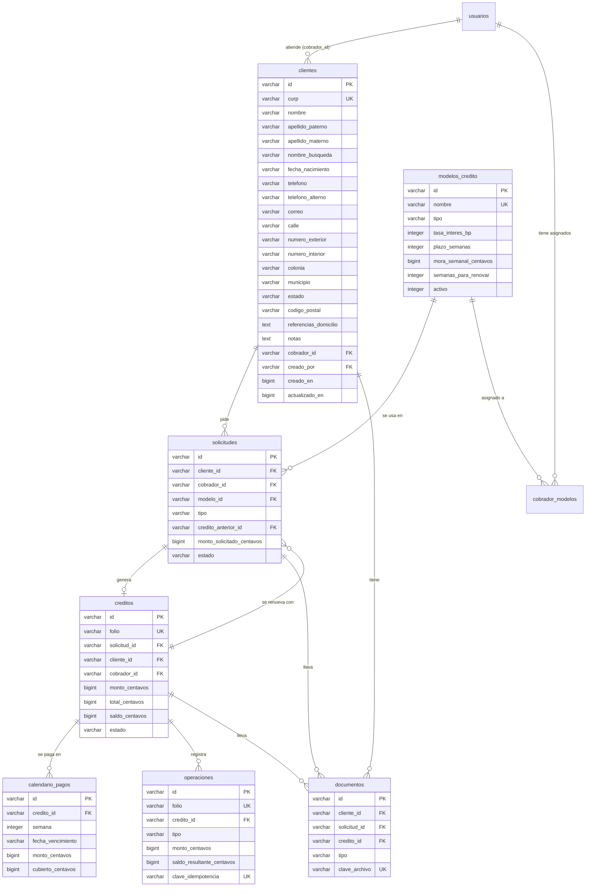
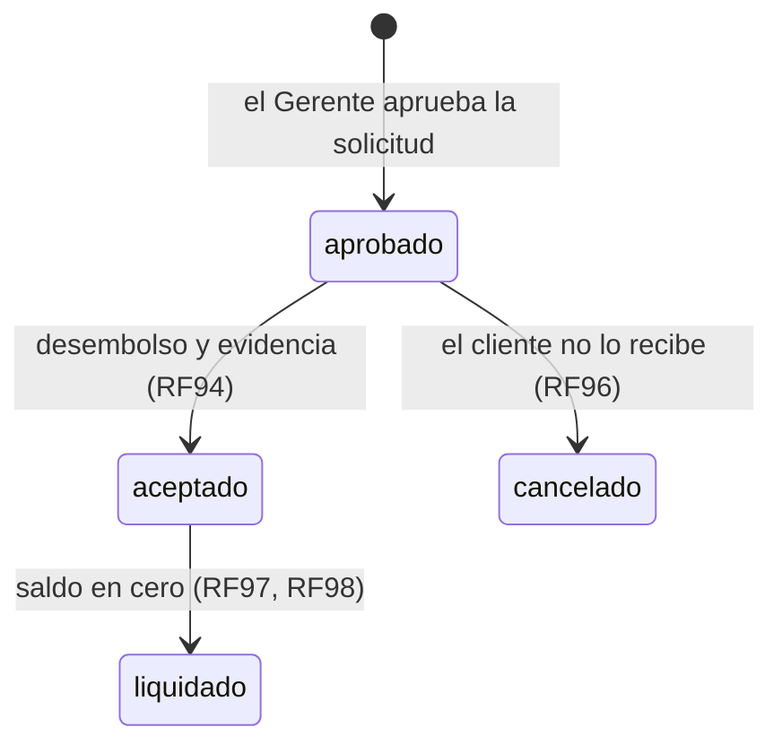

# 2.1 Diseño de la base de datos

**Incremento 2:** Base de datos y gestión de clientes
**Responsable:** Mendoza Abad Jose Alberto
**Basado en:** [1.2 Diseño de usuarios y roles](../incremento-1/1.2-diseno-usuarios-roles.md)
**Requisitos:** RF10–RF23, RF56–RF63, RF117–RF121

## 1. Objetivo

Diseñar las tablas de clientes, créditos y documentos, y la forma de respaldar la información. Las
tablas de créditos dependen de los modelos de crédito y de las solicitudes, por lo que también se
diseñan aquí, aunque sus pantallas y reglas se construyen en los incrementos siguientes.

| Parte | Requisitos | Se crea en |
| --- | --- | --- |
| Clientes | RF10–RF15 | 2.2 (tabla) y 2.3–2.6 (funciones) |
| Modelos de crédito y solicitudes | RF35–RF55 (dependencias de RF56) | 2.2 (tablas); funciones en su incremento |
| Créditos, calendario y operaciones | RF56–RF63 | 2.2 (tablas); funciones en su incremento |
| Documentos | RF17–RF23 | Diseño; tabla y almacenamiento en el incremento de solicitudes |
| Respaldos | RF117–RF121 | 2.7 |

Quedan fuera de este diseño las moras, los códigos de autorización y las notificaciones (RF73–RF81,
RF106–RF108, RF53, RF95, RF103). Se diseñan en su incremento y se agregan con nuevas migraciones,
sin modificar las tablas de este documento.

## 2. Decisiones tomadas

| # | Decisión |
| --- | --- |
| 1 | Datos del cliente: nombre y apellidos, CURP única, fecha de nacimiento, uno o dos teléfonos, correo opcional, domicilio desglosado y notas. |
| 2 | Registran clientes el Cobrador (quedan asignados a él) y el Gerente (elige a cuál de sus Cobradores). El Administrador solo consulta. |
| 3 | Edita el Cobrador sus clientes y el Gerente los de sus Cobradores. Solo el Gerente puede corregir la CURP. Todo cambio queda en la bitácora. |
| 4 | Si la CURP ya existe con otro Cobrador, se avisa sin mostrar datos del cliente. |
| 5 | La transferencia de clientes (RF16) se construye junto con la de créditos (RF29). |
| 6 | Las tablas de créditos y sus dependencias se crean en la tarea 2.2. |
| 7 | Respaldo en dos niveles: historial automático de D1 y exportación semanal a un almacenamiento aparte (sección 8). |
| 8 | Búsqueda: el Cobrador carga su lista completa y busca en el navegador; Gerente y Administrador buscan en el servidor con índices (sección 4.2). |

## 3. Modelo de datos



El diagrama muestra solo las columnas principales; las tablas completas están en las secciones
siguientes.

### Convenciones

Se mantienen las del diseño 1.2 y se agregan tres:

| Dato | Tipo | Motivo |
| --- | --- | --- |
| Dinero | `BIGINT` en **centavos** (`_centavos`) | Los decimales de punto flotante pierden centavos (0.1 + 0.2 ≠ 0.3). Con enteros las sumas son exactas. |
| Porcentajes | `INTEGER` en **centésimas de punto** (`_bp`) | 20 % se guarda como `2000`. Permite tasas como 12.5 % (`1250`) sin decimales. |
| Fechas sin hora | `VARCHAR(10)` con formato `AAAA-MM-DD` | Fechas de calendario (nacimiento, vencimientos) que no dependen de la zona horaria. Se ordenan y comparan como texto. |
| Folios | Texto con serie y número (`CR-000001`) | Legible para el cliente y el personal; se genera con la tabla `folios` (sección 3.9). |

Todas las tablas usan SQL estándar: funcionan igual en SQLite (D1) y en PostgreSQL.

### 3.1 Tabla `clientes` (RF10–RF15)

```sql
CREATE TABLE clientes (
  id                     VARCHAR(36)  PRIMARY KEY,
  curp                   VARCHAR(18)  NOT NULL UNIQUE,   -- en mayúsculas (RN-20)
  nombre                 VARCHAR(80)  NOT NULL,
  apellido_paterno       VARCHAR(80)  NOT NULL,
  apellido_materno       VARCHAR(80),                    -- hay personas con un solo apellido
  nombre_busqueda        VARCHAR(250) NOT NULL,          -- sección 4.2
  fecha_nacimiento       VARCHAR(10)  NOT NULL,          -- AAAA-MM-DD, se toma de la CURP
  telefono               VARCHAR(10)  NOT NULL,
  telefono_alterno       VARCHAR(10),
  correo                 VARCHAR(150),
  calle                  VARCHAR(150) NOT NULL,
  numero_exterior        VARCHAR(20)  NOT NULL,
  numero_interior        VARCHAR(20),
  colonia                VARCHAR(100) NOT NULL,
  municipio              VARCHAR(100) NOT NULL,
  estado                 VARCHAR(50)  NOT NULL,
  codigo_postal          VARCHAR(5)   NOT NULL,
  referencias_domicilio  TEXT,                           -- entre calles, color de la casa…
  notas                  TEXT,
  cobrador_id            VARCHAR(36)  NOT NULL,          -- RF15: Cobrador responsable
  creado_por             VARCHAR(36)  NOT NULL,
  creado_en              BIGINT       NOT NULL,
  actualizado_en         BIGINT       NOT NULL,
  CHECK (LENGTH(curp) = 18),
  CHECK (LENGTH(codigo_postal) = 5),
  FOREIGN KEY (cobrador_id) REFERENCES usuarios (id),
  FOREIGN KEY (creado_por)  REFERENCES usuarios (id)
);

CREATE INDEX idx_clientes_cobrador ON clientes (cobrador_id);
CREATE INDEX idx_clientes_nombre   ON clientes (nombre_busqueda);
CREATE INDEX idx_clientes_telefono ON clientes (telefono);
```

> **¿Por qué no guardar el Gerente en el cliente?** El Gerente se obtiene del Cobrador
> (`usuarios.gerente_id`). Si se guardara también en el cliente, al reasignar un Cobrador habría que
> actualizar todos sus clientes, y un error dejaría datos que no coinciden. La bitácora sí guarda el
> Gerente del momento, como en el Incremento 1.

### 3.2 Tabla `modelos_credito` (RF35–RF40)

```sql
CREATE TABLE modelos_credito (
  id                      VARCHAR(36)  PRIMARY KEY,
  nombre                  VARCHAR(80)  NOT NULL UNIQUE,
  tipo                    VARCHAR(20)  NOT NULL CHECK (tipo IN ('interes_fijo')),  -- RF40: se agregan más
  tasa_interes_bp         INTEGER      NOT NULL CHECK (tasa_interes_bp >= 0),       -- RF37
  plazo_semanas           INTEGER      NOT NULL CHECK (plazo_semanas > 0),          -- RF36: 16
  mora_semanal_centavos   BIGINT       NOT NULL CHECK (mora_semanal_centavos >= 0),
  semanas_para_renovar    INTEGER      NOT NULL CHECK (semanas_para_renovar >= 0),  -- RF83: 4
  activo                  INTEGER      NOT NULL DEFAULT 1 CHECK (activo IN (0, 1)),
  creado_por              VARCHAR(36)  NOT NULL,
  creado_en               BIGINT       NOT NULL,
  actualizado_en          BIGINT       NOT NULL,
  FOREIGN KEY (creado_por) REFERENCES usuarios (id)
);

-- RF27: modelos que puede usar cada Cobrador
CREATE TABLE cobrador_modelos (
  cobrador_id   VARCHAR(36)  NOT NULL,
  modelo_id     VARCHAR(36)  NOT NULL,
  asignado_por  VARCHAR(36)  NOT NULL,
  asignado_en   BIGINT       NOT NULL,
  PRIMARY KEY (cobrador_id, modelo_id),
  FOREIGN KEY (cobrador_id)  REFERENCES usuarios (id),
  FOREIGN KEY (modelo_id)    REFERENCES modelos_credito (id),
  FOREIGN KEY (asignado_por) REFERENCES usuarios (id)
);
```

Cambiar la tasa de un modelo (RF37) no afecta a los créditos existentes: cada solicitud y cada
crédito guardan una **copia** de sus condiciones (RF40, RF58).

### 3.3 Tabla `solicitudes` (RF41–RF55)

```sql
CREATE TABLE solicitudes (
  id                         VARCHAR(36)  PRIMARY KEY,
  cliente_id                 VARCHAR(36)  NOT NULL,
  cobrador_id                VARCHAR(36)  NOT NULL,
  modelo_id                  VARCHAR(36)  NOT NULL,
  tipo                       VARCHAR(15)  NOT NULL CHECK (tipo IN ('nueva', 'renovacion')),
  credito_anterior_id        VARCHAR(36),                  -- solo en renovaciones
  monto_solicitado_centavos  BIGINT       NOT NULL CHECK (monto_solicitado_centavos > 0),
  ocupacion                  VARCHAR(100),                 -- información laboral
  ingreso_semanal_centavos   BIGINT,
  -- Condiciones: se copian del modelo (RF42) y el Gerente las puede ajustar antes de aprobar (RF47, RF48)
  tasa_interes_bp            INTEGER      NOT NULL,
  plazo_semanas              INTEGER      NOT NULL CHECK (plazo_semanas > 0),
  mora_semanal_centavos      BIGINT       NOT NULL,
  estado                     VARCHAR(15)  NOT NULL DEFAULT 'pendiente'
                             CHECK (estado IN ('pendiente', 'aprobada', 'rechazada', 'cancelada')),
  monto_aprobado_centavos    BIGINT,
  fecha_desembolso           VARCHAR(10),                  -- RF52
  motivo                     TEXT,                         -- de rechazo (RF51) o cancelación (RF54)
  revisada_por               VARCHAR(36),                  -- Gerente que decidió
  revisada_en                BIGINT,
  creado_por                 VARCHAR(36)  NOT NULL,
  creado_en                  BIGINT       NOT NULL,
  actualizado_en             BIGINT       NOT NULL,
  CHECK ((tipo = 'renovacion') = (credito_anterior_id IS NOT NULL)),
  CHECK (estado NOT IN ('rechazada', 'cancelada') OR motivo IS NOT NULL),       -- RF51
  CHECK (estado <> 'aprobada' OR (monto_aprobado_centavos > 0 AND fecha_desembolso IS NOT NULL)),
  FOREIGN KEY (cliente_id)          REFERENCES clientes (id),
  FOREIGN KEY (cobrador_id)         REFERENCES usuarios (id),
  FOREIGN KEY (modelo_id)           REFERENCES modelos_credito (id),
  FOREIGN KEY (credito_anterior_id) REFERENCES creditos (id),
  FOREIGN KEY (revisada_por)        REFERENCES usuarios (id),
  FOREIGN KEY (creado_por)          REFERENCES usuarios (id)
);

CREATE INDEX idx_solicitudes_cliente  ON solicitudes (cliente_id, creado_en);
CREATE INDEX idx_solicitudes_cobrador ON solicitudes (cobrador_id, estado);
```

La referencia a `creditos` se declara antes de crear esa tabla; SQLite y PostgreSQL lo permiten
porque la regla se revisa al insertar, no al crear la tabla.

### 3.4 Tabla `creditos` (RF56–RF59)

```sql
CREATE TABLE creditos (
  id                      VARCHAR(36)  PRIMARY KEY,
  folio                   VARCHAR(12)  NOT NULL UNIQUE,  -- CR-000001
  solicitud_id            VARCHAR(36)  NOT NULL UNIQUE,  -- RF56: un crédito por solicitud
  cliente_id              VARCHAR(36)  NOT NULL,
  cobrador_id             VARCHAR(36)  NOT NULL,         -- responsable actual (RF15, RF29)
  modelo_id               VARCHAR(36)  NOT NULL,
  -- RF55, RF58: condiciones con las que se aceptó; no cambian después del desembolso
  monto_centavos          BIGINT       NOT NULL CHECK (monto_centavos > 0),   -- lo que recibe el cliente
  tasa_interes_bp         INTEGER      NOT NULL,
  plazo_semanas           INTEGER      NOT NULL CHECK (plazo_semanas > 0),
  mora_semanal_centavos   BIGINT       NOT NULL,
  interes_centavos        BIGINT       NOT NULL,
  total_centavos          BIGINT       NOT NULL,         -- monto + interés
  pago_semanal_centavos   BIGINT       NOT NULL,
  saldo_centavos          BIGINT       NOT NULL CHECK (saldo_centavos >= 0),  -- RF59
  estado                  VARCHAR(12)  NOT NULL DEFAULT 'aprobado'
                          CHECK (estado IN ('aprobado', 'aceptado', 'liquidado', 'cancelado')),
  fecha_desembolso        VARCHAR(10)  NOT NULL,
  aceptado_en             BIGINT,                        -- RF94
  liquidado_en            BIGINT,
  tipo_liquidacion        VARCHAR(10)  CHECK (tipo_liquidacion IN ('normal', 'anticipada')),
  creado_en               BIGINT       NOT NULL,
  actualizado_en          BIGINT       NOT NULL,
  CHECK (total_centavos = monto_centavos + interes_centavos),
  CHECK (saldo_centavos <= total_centavos),
  CHECK (estado <> 'liquidado' OR (saldo_centavos = 0 AND liquidado_en IS NOT NULL)),
  FOREIGN KEY (solicitud_id) REFERENCES solicitudes (id),
  FOREIGN KEY (cliente_id)   REFERENCES clientes (id),
  FOREIGN KEY (cobrador_id)  REFERENCES usuarios (id),
  FOREIGN KEY (modelo_id)    REFERENCES modelos_credito (id)
);

CREATE INDEX idx_creditos_cliente  ON creditos (cliente_id, estado);
CREATE INDEX idx_creditos_cobrador ON creditos (cobrador_id, estado);
```

**Estados del crédito (RF57):**



- **Aprobado:** existe el crédito con sus condiciones, pero el cliente aún no recibe el dinero.
- **Aceptado:** el cliente recibió el dinero; es el crédito **vigente**, sobre el que se registran
  pagos y abonos. Se usa "Aceptado" porque así lo nombra RF94.
- **Liquidado** y **cancelado** son estados finales: el crédito ya no recibe operaciones.

### 3.5 Tabla `calendario_pagos` (RF61, RF62)

```sql
CREATE TABLE calendario_pagos (
  id                 VARCHAR(36)  PRIMARY KEY,
  credito_id         VARCHAR(36)  NOT NULL,
  semana             INTEGER      NOT NULL CHECK (semana > 0),
  fecha_vencimiento  VARCHAR(10)  NOT NULL,
  monto_centavos     BIGINT       NOT NULL CHECK (monto_centavos > 0),
  cubierto_centavos  BIGINT       NOT NULL DEFAULT 0,  -- pagos y abonos acumulados (RF66, RF68)
  CHECK (cubierto_centavos BETWEEN 0 AND monto_centavos),
  UNIQUE (credito_id, semana),
  FOREIGN KEY (credito_id) REFERENCES creditos (id)
);
```

Una semana está pagada cuando `cubierto_centavos = monto_centavos`. Un abono a una semana futura
(RF65) suma a `cubierto_centavos` hasta completarla; al llegar al monto se convierte en pago (RF66).

**Cálculo del modelo de interés fijo (RF36, RF61):**

1. `interes = monto × tasa_interes_bp / 10 000`, redondeado al centavo.
2. `total = monto + interes`.
3. `pago semanal = total / plazo`, redondeado hacia abajo al peso. La diferencia se suma a la
   **última semana**, para que el total cuadre exactamente.
4. La semana 1 vence 7 días después de la fecha de desembolso, y cada semana siguiente 7 días después.

Ejemplo: $5,000 al 20 % en 16 semanas → interés $1,000, total $6,000, 16 pagos de $375.

### 3.6 Tabla `operaciones` (RF60, RF113, RF115)

Historial de todo lo que cambia el saldo de un crédito. Las operaciones nunca se modifican ni se
eliminan: una corrección se registra como una operación nueva que apunta a la original (RF72).

```sql
CREATE TABLE operaciones (
  id                         VARCHAR(36)  PRIMARY KEY,
  folio                      VARCHAR(12)  NOT NULL UNIQUE,  -- OP-000001 (RF113)
  credito_id                 VARCHAR(36)  NOT NULL,
  tipo                       VARCHAR(15)  NOT NULL
                             CHECK (tipo IN ('desembolso', 'pago', 'abono', 'liquidacion', 'correccion')),
  semana                     INTEGER,                       -- semana a la que se aplica
  monto_centavos             BIGINT       NOT NULL,
  saldo_resultante_centavos  BIGINT       NOT NULL,         -- RF116: saldo después de la operación
  operacion_corregida_id     VARCHAR(36),                   -- solo en correcciones
  motivo                     TEXT,
  clave_idempotencia         VARCHAR(36)  NOT NULL UNIQUE,  -- RN-24
  registrado_por             VARCHAR(36)  NOT NULL,
  registrado_en              BIGINT       NOT NULL,
  CHECK ((tipo = 'correccion') = (operacion_corregida_id IS NOT NULL)),
  CHECK (tipo <> 'correccion' OR motivo IS NOT NULL),
  FOREIGN KEY (credito_id)             REFERENCES creditos (id),
  FOREIGN KEY (operacion_corregida_id) REFERENCES operaciones (id),
  FOREIGN KEY (registrado_por)         REFERENCES usuarios (id)
);

CREATE INDEX idx_operaciones_credito ON operaciones (credito_id, registrado_en);
```

> **Idempotencia (`clave_idempotencia`).** Cuando el Cobrador presiona "Guardar", la aplicación genera
> una clave única para esa operación. Si la conexión falla y el envío se repite, la base de datos
> rechaza la segunda copia porque la clave ya existe. Así un reintento nunca duplica un pago.

### 3.7 Tabla `documentos` (RF17–RF23)

Los archivos (fotografías, PDF firmados) no se guardan en la base de datos, sino en un almacenamiento
de archivos privado. La tabla guarda de qué es cada archivo y dónde está.

```sql
CREATE TABLE documentos (
  id             VARCHAR(36)  PRIMARY KEY,
  cliente_id     VARCHAR(36)  NOT NULL,
  solicitud_id   VARCHAR(36),                   -- RF18: conjunto propio de cada solicitud
  credito_id     VARCHAR(36),                   -- RF20: se liga al crédito al generarse
  tipo           VARCHAR(30)  NOT NULL
                 CHECK (tipo IN ('identificacion', 'comprobante_domicilio', 'solicitud_firmada',
                                 'contrato_firmado', 'evidencia_desembolso',
                                 'comprobante_liquidacion', 'otro')),
  clave_archivo  VARCHAR(200) NOT NULL UNIQUE,  -- ubicación en el almacenamiento
  nombre_archivo VARCHAR(200) NOT NULL,
  tipo_mime      VARCHAR(100) NOT NULL,
  tamano_bytes   BIGINT       NOT NULL CHECK (tamano_bytes > 0),
  subido_por     VARCHAR(36)  NOT NULL,
  subido_en      BIGINT       NOT NULL,
  CHECK (solicitud_id IS NOT NULL OR credito_id IS NOT NULL),
  FOREIGN KEY (cliente_id)   REFERENCES clientes (id),
  FOREIGN KEY (solicitud_id) REFERENCES solicitudes (id),
  FOREIGN KEY (credito_id)   REFERENCES creditos (id),
  FOREIGN KEY (subido_por)   REFERENCES usuarios (id)
);

CREATE INDEX idx_documentos_solicitud ON documentos (solicitud_id);
CREATE INDEX idx_documentos_credito   ON documentos (credito_id);
```

- **RF19:** un documento nunca se reemplaza. Si se sube otra versión, se agrega un registro nuevo y
  el anterior se conserva.
- **RF23, RF105:** el almacenamiento es privado. Los archivos solo se descargan a través de la API,
  que primero revisa que el usuario tenga permiso sobre ese cliente.
- **Almacenamiento:** Cloudflare R2, en un espacio (*bucket*) privado exclusivo para documentos.

### 3.8 Tabla `respaldos` (RF117–RF121)

Registro de cada respaldo automático, para saber cuándo se hizo el último y si terminó bien.

```sql
CREATE TABLE respaldos (
  id            VARCHAR(36)  PRIMARY KEY,
  iniciado_en   BIGINT       NOT NULL,
  terminado_en  BIGINT,
  estado        VARCHAR(12)  NOT NULL CHECK (estado IN ('en_proceso', 'correcto', 'fallido')),
  archivo       VARCHAR(200),                  -- ubicación del respaldo
  tamano_bytes  BIGINT,
  error         TEXT
);
```

### 3.9 Tabla `folios` (RF113)

```sql
CREATE TABLE folios (
  serie   VARCHAR(10)  PRIMARY KEY,   -- 'CR' créditos, 'OP' operaciones
  ultimo  BIGINT       NOT NULL DEFAULT 0
);
```

Cada operación aumenta `ultimo` en la misma transacción en que se guarda, así dos operaciones
simultáneas nunca reciben el mismo folio. No se usa `AUTOINCREMENT` porque no es SQL estándar.

## 4. Gestión de clientes

### 4.1 Matriz de permisos

| Acción | Administrador | Gerente | Cobrador |
| --- | :---: | :---: | :---: |
| Registrar cliente | ❌ | ✅ (elige a cuál de sus Cobradores) | ✅ (queda asignado a él) |
| Editar datos del cliente | ❌ | ✅ los de sus Cobradores | ✅ los suyos |
| Corregir la CURP | ❌ | ✅ | ❌ |
| Consultar clientes | ✅ todos (solo consulta) | ✅ los de sus Cobradores | ✅ los suyos |
| Transferir cliente a otro Cobrador | — | Con RF29 (incremento de créditos) | — |

### 4.2 Búsqueda (RF11, RNF06)

- **Cobrador:** la lista de sus clientes se carga completa y la búsqueda se hace en el navegador. Un
  Cobrador atiende decenas o cientos de clientes, así que la lista es pequeña, la búsqueda es
  instantánea y funciona aunque se pierda la señal un momento.
- **Gerente y Administrador:** la búsqueda se hace en el servidor y regresa páginas de resultados:
  - **CURP:** búsqueda exacta, con el índice único.
  - **Teléfono:** búsqueda exacta, con `idx_clientes_telefono`.
  - **Nombre:** búsqueda por el inicio de `nombre_busqueda`, con `idx_clientes_nombre`.

`nombre_busqueda` guarda el nombre completo en minúsculas y sin acentos, empezando por los
apellidos: `perez lopez maria jose`. Buscar "perez lo" usa el índice con una condición de rango
(`nombre_busqueda >= 'perez lo' AND nombre_busqueda < 'perez lp'`), que funciona igual en SQLite y
PostgreSQL. Una búsqueda que contenga el texto en cualquier parte (`LIKE '%texto%'`) obligaría a
leer toda la tabla.

### 4.3 Reglas de negocio

| ID | Regla |
| --- | --- |
| RN-20 | La CURP es obligatoria, tiene 18 caracteres con el formato oficial y se guarda en mayúsculas. No puede haber dos clientes con la misma CURP. |
| RN-21 | La fecha de nacimiento se toma de la CURP y no se captura por separado. |
| RN-22 | Los teléfonos tienen 10 dígitos. El correo es opcional, pero si se captura debe tener un formato válido. |
| RN-23 | Si se intenta registrar una CURP que ya existe con otro Cobrador, se responde "Este cliente ya está registrado; consulta con tu Gerente", sin mostrar sus datos. |
| RN-24 | Toda operación financiera lleva una clave de idempotencia; la base de datos rechaza una clave repetida. |
| RN-25 | Los clientes no se eliminan: conservan su historial de solicitudes y créditos (RF14). |
| RN-26 | Cada cambio a los datos de un cliente se registra en la bitácora con los valores anteriores y los nuevos (RNF29). |

**Acciones nuevas en la bitácora:** `cliente_creado`, `cliente_modificado`.

### 4.4 Historial del cliente (RF14)

El historial no necesita una tabla propia: se obtiene de las solicitudes y los créditos del cliente
(`cliente_id`), con sus operaciones. Mientras no existan créditos, la ficha del cliente lo muestra
vacío.

## 5. API prevista

| Método | Ruta | Quién | Descripción |
| --- | --- | --- | --- |
| GET | `/api/clientes` | Todos | Cobrador: su lista completa. Gerente y Administrador: búsqueda paginada (`?q=&cobradorId=&pagina=`) |
| POST | `/api/clientes` | Gerente, Cobrador | Registra un cliente |
| GET | `/api/clientes/:id` | Todos (según su ámbito) | Ficha del cliente, con su Cobrador e historial |
| PATCH | `/api/clientes/:id` | Gerente, Cobrador | Edita los datos (la CURP solo el Gerente) |

## 6. Pantallas previstas

| Pantalla | Ruta | Roles |
| --- | --- | --- |
| Clientes (lista y búsqueda) | `/clientes` | Todos |
| Alta de cliente | `/clientes/nuevo` | Gerente, Cobrador |
| Ficha del cliente y edición | `/clientes/[id]` | Todos (edición: Gerente y Cobrador) |

El Cobrador, que hasta ahora no tenía menú, verá la opción **Clientes**.

## 7. Integridad de la información

- **Llaves foráneas:** D1 las revisa siempre. Ningún registro puede apuntar a un cliente, usuario o
  crédito que no existe.
- **`CHECK`:** las reglas que se pueden expresar en la base de datos (estados válidos, montos
  positivos, motivo obligatorio al rechazar) se declaran ahí, además de validarse con Zod. Si el
  código tuviera un error, la base de datos lo rechaza.
- **Transacciones (RF110–RF112):** las operaciones que tocan varias tablas (registrar un pago,
  generar un crédito con su calendario) se envían juntas con `db.batch()`. D1 las ejecuta como una
  sola transacción: se guardan todas o ninguna.

## 8. Respaldos (RF117–RF121)

| Nivel | Qué es | Requisitos |
| --- | --- | --- |
| 1. Historial de D1 (*Time Travel*) | Automático y siempre activo. Permite regresar la base de datos a cualquier minuto de los últimos **7 días** (30 en el plan de pago). | RF117, RF119 |
| 2. Exportación semanal | Una tarea programada exporta la base de datos completa cada semana y la guarda en un *bucket* de R2 exclusivo para respaldos, separado de la base de datos. | RF117, RF118, RF121 |

- **RF118 (documentos):** los documentos nunca se reemplazan ni se borran (RF19), y la tarea semanal
  copia los archivos nuevos al *bucket* de respaldos.
- **RF120 (conservación):** los respaldos semanales se conservan **12 semanas**. Una regla de
  ciclo de vida de R2 borra automáticamente los más antiguos.
- **RF119 (recuperación):** se documentará el procedimiento para restaurar desde el historial de D1
  (`wrangler d1 time-travel restore`) y desde una exportación, y se probará en la tarea 2.8.
- Cloudflare publica un ejemplo oficial de esta tarea (exportar D1 a R2 con un *cron*); se adaptará
  en la tarea 2.7.

## 9. Trazabilidad con las tareas siguientes

| Tarea | Qué se construye de este diseño |
| --- | --- |
| 2.2 Creación de tablas | Migración con `clientes`, `modelos_credito`, `cobrador_modelos`, `solicitudes`, `creditos`, `calendario_pagos`, `operaciones` y `folios` |
| 2.3 Registro de clientes | Alta con validación de CURP, teléfonos y domicilio (RN-20 a RN-23) |
| 2.4 Edición de datos | Edición según la matriz 4.1, con registro en la bitácora (RN-26) |
| 2.5 Consulta de clientes | Ficha del cliente con su Cobrador e historial (sección 4.4) |
| 2.6 Búsqueda y filtrado | Búsqueda según la sección 4.2 |
| 2.7 Respaldo de datos | Tabla `respaldos`, tarea semanal y conservación (sección 8) |
| 2.8 Pruebas del módulo | Pruebas de permisos, validaciones, búsqueda y recuperación de un respaldo |
