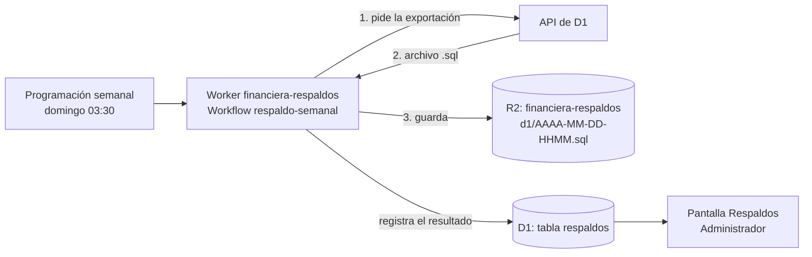

# 2.7 Respaldo de datos

**Incremento 2:** Base de datos y gestión de clientes
**Responsable:** Mendoza Abad Jose Alberto
**Basado en:** [2.1 Diseño de la base de datos](2.1-diseno-base-de-datos.md), sección 8
**Requisitos:** RF117–RF121

## 1. Cómo se cumple cada requisito

| ID | Requisito | Cómo se cumple |
| --- | --- | --- |
| RF117 | Respaldo automático | Dos niveles: el historial de D1 (*Time Travel*), siempre activo, y una exportación completa cada domingo a las 03:30 (hora del centro de México). |
| RF118 | Respaldo de documentos | Los documentos nunca se reemplazan ni se borran (RF19). Cuando exista su almacenamiento (incremento de solicitudes), la tarea semanal copiará los archivos nuevos al *bucket* de respaldos. |
| RF119 | Recuperación | Procedimientos de la sección 4. |
| RF120 | Conservación | Una regla de R2 borra los respaldos de más de 12 semanas (84 días). El historial de D1 cubre los últimos 7 días. |
| RF121 | Ubicación separada | Los respaldos se guardan en R2, un servicio distinto de la base de datos, en un *bucket* privado exclusivo para respaldos. |

## 2. Componentes



- **Worker `financiera-respaldos`** ([respaldos/](../../respaldos/)): está separado de la aplicación, así que un cambio en uno no afecta al otro (RNF21). No tiene dirección pública.
- **Programación:** una tarea programada del Worker (*Cron Trigger*, gratuita) inicia el Workflow cada
  domingo. Cloudflare solo permite programar un Workflow directamente en el plan de pago.
- **Workflow:** cada paso se reintenta solo si falla, por ejemplo si la exportación todavía no está lista. La exportación la hace Cloudflare, por lo que el Worker casi no gasta CPU.
- **Tabla `respaldos`:** guarda fecha, estado (en proceso, correcto o fallido), archivo, tamaño y, si falló, el error.
- **Pantalla Respaldos** (`/respaldos`): solo el Administrador la ve. Muestra los últimos 12 respaldos.

## 3. Configuración (una sola vez)

1. **Activar R2** en el panel de Cloudflare (**R2 Object Storage**). Lo hace el dueño de la cuenta, porque Cloudflare pide aceptar sus términos.
2. **Crear el *bucket*** y la regla de conservación:
   ```sh
   npx wrangler r2 bucket create financiera-respaldos
   npx wrangler r2 bucket lifecycle add financiera-respaldos borrar-antiguos d1/ --expire-days 84
   ```
3. **Crear el token de la API** en **Mi perfil → Tokens de API → Crear token → Token personalizado**:
   - Permiso: **Cuenta · D1 · Editar** (la exportación usa ese permiso).
   - Recursos de la cuenta: solo la cuenta de la financiera.
4. **Guardar el token como secreto.** El token no se escribe en ningún archivo:
   ```sh
   cd respaldos
   npx wrangler secret put TOKEN_EXPORTAR_D1
   ```
5. **Publicar el Worker** y hacer un primer respaldo de prueba:
   ```sh
   cd respaldos
   npx wrangler deploy
   npx wrangler workflows trigger respaldo-semanal
   ```
   El resultado aparece en la pantalla **Respaldos** y en el panel de Cloudflare (**Workflows**).

## 4. Recuperación (RF119)

### 4.1 Error reciente (últimos 7 días): historial de D1

Regresa la base de datos al estado de un momento exacto. Sirve, por ejemplo, si se borró o modificó
información por error.

```sh
# 1. Ver a qué estado se regresaría (fecha en segundos desde 1970)
npx wrangler d1 time-travel info financiera --timestamp=1793000000

# 2. Restaurar. Reemplaza la base actual. El comando imprime un marcador para deshacer la restauración.
npx wrangler d1 time-travel restore financiera --timestamp=1793000000
```

### 4.2 Pérdida mayor: desde una exportación semanal

Primero se restaura en una base **nueva** para revisar el respaldo sin tocar la de producción.

```sh
# 1. Ver los respaldos disponibles en el panel (R2 → financiera-respaldos) y descargar uno
npx wrangler r2 object get financiera-respaldos/d1/2026-10-25-0930.sql --file=respaldo.sql --remote

# 2. Reacomodar el archivo para que se pueda cargar (ver la nota de abajo)
node scripts/preparar-respaldo.mjs respaldo.sql respaldo-listo.sql

# 3. Crear una base nueva y cargar el respaldo
npx wrangler d1 create financiera-restaurada
npx wrangler d1 execute financiera-restaurada --remote --file=respaldo-listo.sql

# 4. Revisar que los datos estén completos y sin referencias rotas
npx wrangler d1 execute financiera-restaurada --remote --command "SELECT COUNT(*) FROM usuarios"
npx wrangler d1 execute financiera-restaurada --remote --command "SELECT COUNT(*) FROM clientes"
npx wrangler d1 execute financiera-restaurada --remote --command "PRAGMA foreign_key_check"
```

> **¿Por qué hay que reacomodar el respaldo?** La exportación de D1 escribe cada tabla seguida de sus
> datos, en orden alfabético: los registros de `bitacora` aparecen antes de que exista `usuarios`, a
> la que apuntan. Cargado tal cual, falla con `no such table: main.usuarios` o `D1_RESET_DO`.
> [scripts/preparar-respaldo.mjs](../../scripts/preparar-respaldo.mjs) pone primero todas las tablas,
> después los datos de cada tabla detrás de los de las tablas a las que apunta, y al final los
> índices. No cambia ningún dato: solo quita dos líneas de la tabla interna `sqlite_sequence`, que
> D1 no deja modificar y que SQLite vuelve a llenar sola.

Si el respaldo está bien, se cambia el `database_id` en `wrangler.jsonc` (y en
`respaldos/wrangler.jsonc`) por el de la base restaurada y se vuelve a publicar la aplicación.

### 4.3 Recomendaciones

- Revisar cada lunes en la pantalla **Respaldos** que el último respaldo esté **Correcto**.
- Para tener una copia fuera de Cloudflare, descargar de vez en cuando un respaldo (paso 4.2.1) y
  guardarlo en otro lugar, por ejemplo una memoria USB o el servidor de la financiera.
- Probar la recuperación (4.2) al menos una vez, para confirmar que los respaldos sirven (tarea 2.8).
