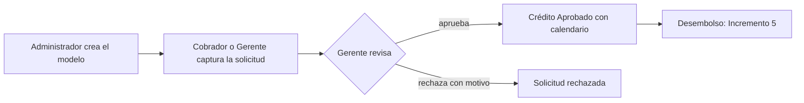

# 3.1 Solicitudes y aprobación de créditos

**Incremento 3:** Solicitudes y aprobación de créditos
**Responsable:** Mancera Herrera Luis Santiago
**Basado en:** [2.1 Diseño de la base de datos](../incremento-2/2.1-diseno-base-de-datos.md) (tablas `modelos_credito`, `solicitudes`, `creditos`, `calendario_pagos`, `folios`)
**Requisitos:** RF35–RF52, RF56–RF61, RF113

Cubre las tareas 3 a 3.5 del plan: captura de solicitudes, registro del monto, evaluación, aprobación
o rechazo, historial de solicitudes y consulta de créditos autorizados. No se necesitaron tablas
nuevas: todo usa las del diseño 2.1.

## 1. Flujo

## 2. Matriz de permisos

| Acción | Administrador | Gerente | Cobrador |
| --- | :---: | :---: | :---: |
| Crear, activar o desactivar modelos de crédito | ✅ | consulta | consulta |
| Capturar una solicitud | ❌ | ✅ (clientes de sus Cobradores) | ✅ (sus clientes) |
| Aprobar o rechazar | ❌ | ✅ (solicitudes de sus Cobradores) | ❌ |
| Consultar solicitudes | ✅ todas | ✅ las de sus Cobradores | ✅ las suyas |

## 3. Reglas de negocio

| ID | Regla |
| --- | --- |
| RN-30 | Un cliente no puede tener otra solicitud mientras tenga una pendiente o un crédito aprobado sin desembolsar. Con un crédito vigente, solo puede pedir una renovación (Incremento 5, RN-50). |
| RN-31 | Las condiciones (tasa, plazo, mora) se copian del modelo a la solicitud (RF42). El Gerente puede ajustar monto, tasa y plazo antes de aprobar (RF47, RF48); los cambios posteriores al modelo no afectan a solicitudes ni créditos existentes (RF58). |
| RN-32 | Un modelo desactivado ya no se ofrece en solicitudes nuevas (RF39). |
| RN-33 | El rechazo exige motivo (RF51). Una solicitud revisada no se puede volver a revisar. |
| RN-34 | Al aprobar se genera el crédito en estado **Aprobado** con su folio `CR-000001` y su calendario (diseño 2.1, sección 3.5): interés fijo, pago semanal redondeado hacia abajo al peso y la diferencia en la última semana. |
| RN-35 | Si dos Gerentes revisan la misma solicitud al mismo tiempo, solo la primera revisión se guarda; la segunda recibe un aviso (RNF05). |

### Cómo se garantiza que nada quede a medias

La aprobación es un solo `db.batch()` (una transacción en D1): toma el folio, crea el crédito con
`INSERT … SELECT … WHERE estado = 'pendiente'`, marca la solicitud como aprobada, crea las semanas del
calendario y registra la bitácora. Cada consulta depende de la anterior: si la solicitud ya no estaba
pendiente, ninguna cambia nada y la API responde 409. El folio solo avanza si el crédito se crea, así
que no quedan huecos.

> **Nota técnica.** Drizzle no admite SQL crudo con parámetros dentro de `db.batch()` en D1. Por eso
> los `INSERT … SELECT` se arman con `insertarSi` (`server/utils/bd.ts`), que usa el constructor de
> consultas.

**Acciones nuevas en la bitácora:** `modelo_creado`, `modelo_modificado`, `solicitud_creada`,
`solicitud_aprobada`, `solicitud_rechazada`.

## 4. API

| Método | Ruta | Quién | Descripción |
| --- | --- | --- | --- |
| GET | `/api/modelos` | Todos | Lista de modelos |
| POST | `/api/modelos` | Administrador | Alta de modelo |
| POST | `/api/modelos/:id/activo` | Administrador | Activa o desactiva |
| GET | `/api/solicitudes?estado=` | Todos (según su ámbito) | Solicitudes con cliente, Cobrador, modelo y crédito generado |
| POST | `/api/solicitudes` | Gerente, Cobrador | Nueva solicitud (o renovación) |
| POST | `/api/solicitudes/:id/aprobar` | Gerente | Aprueba y genera el crédito |
| POST | `/api/solicitudes/:id/rechazar` | Gerente | Rechaza con motivo |

## 5. Pantallas

| Pantalla | Ruta | Roles |
| --- | --- | --- |
| Modelos de crédito | `/modelos` | Administrador (alta), Gerente (consulta) |
| Nueva solicitud | `/clientes/:id/solicitud` (botón en la ficha del cliente) | Gerente, Cobrador |
| Solicitudes, aprobación y rechazo | `/solicitudes` | Todos (aprobar: Gerente) |
| Historial de solicitudes del cliente | Ficha del cliente | Todos (según su ámbito) |

Las pruebas están en [3.6 Pruebas del módulo](3.6-pruebas-del-modulo.md).
