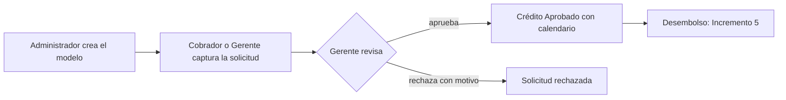

# 3.1 Solicitudes y aprobación de créditos

**Incremento 3:** Solicitudes y aprobación de créditos
**Responsable:** Mancera Herrera Luis Santiago
**Basado en:** [2.1 Diseño de la base de datos](../incremento-2/2.1-diseno-base-de-datos.md) (tablas `modelos_credito`, `solicitudes`, `creditos`, `calendario_pagos`, `folios`)
**Requisitos:** RF17–RF23, RF27, RF35–RF52, RF56–RF61, RF113, RF118

Cubre las tareas 3 a 3.5 del plan: captura de solicitudes (con sus documentos), registro del monto,
evaluación, aprobación o rechazo, historial de solicitudes y consulta de créditos autorizados. Usa las
tablas del diseño 2.1 y agrega la de documentos (sección 6, migración `0007_documentos`).

## 1. Flujo



## 2. Matriz de permisos

| Acción | Administrador | Gerente | Cobrador |
| --- | :---: | :---: | :---: |
| Crear, activar o desactivar modelos de crédito | ✅ | consulta | consulta |
| Capturar una solicitud | ❌ | ✅ (clientes de sus Cobradores) | ✅ (sus clientes) |
| Aprobar o rechazar | ❌ | ✅ (solicitudes de sus Cobradores) | ❌ |
| Consultar solicitudes | ✅ todas | ✅ las de sus Cobradores | ✅ las suyas |
| Asignar modelos a un Cobrador (RF27) | ✅ | ✅ (sus Cobradores) | ❌ |
| Subir documentos del cliente | ❌ | ✅ (clientes de sus Cobradores) | ✅ (sus clientes) |
| Ver o descargar documentos | ✅ todos | ✅ los de sus Cobradores | ✅ los suyos |

## 3. Reglas de negocio

| ID | Regla |
| --- | --- |
| RN-30 | Un cliente no puede tener otra solicitud mientras tenga una pendiente o un crédito aprobado sin desembolsar. Con un crédito vigente, solo puede pedir una renovación (Incremento 5, RN-50). |
| RN-31 | Las condiciones (tasa, plazo, mora) se copian del modelo a la solicitud (RF42). El Gerente puede ajustar monto, tasa y plazo antes de aprobar (RF47, RF48); los cambios posteriores al modelo no afectan a solicitudes ni créditos existentes (RF58). |
| RN-32 | Un modelo desactivado ya no se ofrece en solicitudes nuevas (RF39). |
| RN-33 | El rechazo exige motivo (RF51). Una solicitud revisada no se puede volver a revisar. |
| RN-34 | Al aprobar se genera el crédito en estado **Aprobado** con su folio `CR-000001` y su calendario (diseño 2.1, sección 3.5): interés fijo, pago semanal redondeado hacia abajo al peso y la diferencia en la última semana. |
| RN-35 | Si dos Gerentes revisan la misma solicitud al mismo tiempo, solo la primera revisión se guarda; la segunda recibe un aviso (RNF05). |
| RN-36 | **Modelos por Cobrador** (RF27): el Gerente (o el Administrador) marca qué modelos puede ofrecer cada Cobrador. Si no tiene ninguno marcado, puede usar todos los activos; en cuanto tiene alguno, solo esos. La regla se revisa en la API al capturar la solicitud. |
| RN-37 | **Documentos** (RF17–RF22): fotos (JPG, PNG, WEBP, HEIC) o PDF de hasta 10 MB. Lo que se sube desde la ficha del cliente con una solicitud pendiente queda en esa solicitud; al aprobarla pasa al crédito (RF20). Desde el crédito se sube la evidencia del desembolso. |
| RN-38 | Un documento nunca se reemplaza ni se borra (RF19): otra versión es un documento nuevo y la anterior se conserva. |

### Cómo se garantiza que nada quede a medias

La aprobación es un solo `db.batch()` (una transacción en D1): toma el folio, crea el crédito con
`INSERT … SELECT … WHERE estado = 'pendiente'`, marca la solicitud como aprobada, crea las semanas del
calendario y registra la bitácora. Cada consulta depende de la anterior: si la solicitud ya no estaba
pendiente, ninguna cambia nada y la API responde 409. El folio solo avanza si el crédito se crea, así
que no quedan huecos.

> **Nota técnica.** Drizzle no admite SQL crudo con parámetros dentro de `db.batch()` en D1. Por eso
> los `INSERT … SELECT` se arman con `insertarSi` (`server/utils/bd.ts`), que usa el constructor de
> consultas.

**Acciones nuevas en la bitácora:** `modelo_creado`, `modelo_modificado`, `solicitud_creada`,
`solicitud_aprobada`, `solicitud_rechazada`.

## 4. Documentos (RF17–RF23, RF118)

```sql
CREATE TABLE documentos (
  id             VARCHAR(36)  PRIMARY KEY,
  cliente_id     VARCHAR(36)  NOT NULL REFERENCES clientes (id),
  solicitud_id   VARCHAR(36)  REFERENCES solicitudes (id),   -- RF18
  credito_id     VARCHAR(36)  REFERENCES creditos (id),      -- RF20: al aprobarse la solicitud
  tipo           VARCHAR(30)  NOT NULL CHECK (tipo IN ('identificacion', 'comprobante_domicilio',
                   'solicitud_firmada', 'contrato_firmado', 'evidencia_desembolso',
                   'comprobante_liquidacion', 'otro')),
  clave_archivo  VARCHAR(200) NOT NULL UNIQUE,               -- ubicación en R2
  nombre_archivo VARCHAR(200) NOT NULL,
  tipo_mime      VARCHAR(100) NOT NULL,
  tamano_bytes   BIGINT       NOT NULL CHECK (tamano_bytes > 0),
  subido_por     VARCHAR(36)  NOT NULL REFERENCES usuarios (id),
  subido_en      BIGINT       NOT NULL
);
```

- **Cambio respecto al diseño 2.1:** la solicitud y el crédito son opcionales. La identificación y el
  comprobante de domicilio son del cliente y sirven para varias solicitudes.
- **Almacenamiento (RF23, RF105):** bucket privado de R2 `financiera-documentos`. Los archivos solo se
  descargan por `GET /api/documentos/:id`, que antes revisa que el usuario pueda ver al cliente.
- **Subida:** el archivo va como cuerpo crudo de la petición (no *multipart*), así el Worker no tiene
  que procesarlo y no se acerca al límite de 10 ms de CPU del plan gratuito. Si el registro en la base
  falla, el archivo se borra de R2 para no dejarlo huérfano.
- **Respaldo (RF118):** cada domingo, después de exportar la base de datos, el Workflow
  `respaldo-semanal` hace una **copia íntegra** del bucket `financiera-documentos` a
  `financiera-respaldos/documentos/<fecha>/<clave original>`, con la misma fecha que el `.sql`
  (`d1/2026-11-23-0930.sql` ↔ `documentos/2026-11-23-0930/…`). Así cada respaldo semanal tiene la base y
  los documentos de ese momento.
  - Copia por lotes de 20 objetos, un paso del Workflow por lote (`copiar documentos (lote N)`): cada
    paso queda dentro del límite de 50 subpeticiones del plan gratuito y, si falla, solo se reintenta ese lote.
  - Cada copia conserva el tipo de archivo y los metadatos, y se escribe con el MD5 del original: R2 la
    rechaza si el contenido no coincide. También se compara el tamaño.
  - El resultado se registra junto con el respaldo, en la bitácora: acción "Respaldo semanal", usuario
    "Sistema", con el número de documentos y los MB copiados. Si la copia falla, el respaldo queda
    "fallido" con el error, igual que si fallara la base de datos.
  - Conservación: con una regla de R2 para el prefijo `documentos/` (84 días, ver
    [2.7](../incremento-2/2.7-respaldo-de-datos.md)) se guardan las últimas 12 semanas, igual que la base.

## 5. API

| Método | Ruta | Quién | Descripción |
| --- | --- | --- | --- |
| GET | `/api/modelos` | Todos | Lista de modelos |
| POST | `/api/modelos` | Administrador | Alta de modelo |
| POST | `/api/modelos/:id/activo` | Administrador | Activa o desactiva |
| GET | `/api/solicitudes?estado=` | Todos (según su ámbito) | Solicitudes con cliente, Cobrador, modelo y crédito generado |
| POST | `/api/solicitudes` | Gerente, Cobrador | Nueva solicitud (o renovación) |
| POST | `/api/solicitudes/:id/aprobar` | Gerente | Aprueba y genera el crédito |
| POST | `/api/solicitudes/:id/rechazar` | Gerente | Rechaza con motivo |
| PUT | `/api/usuarios/:id/modelos` | Administrador, Gerente | Modelos que puede usar un Cobrador (RF27) |
| POST | `/api/clientes/:id/documentos?tipo=&nombre=&solicitudId=&creditoId=` | Gerente, Cobrador | Sube un documento (el archivo en el cuerpo) |
| GET | `/api/documentos/:id` | Todos (según su ámbito) | Muestra o descarga el archivo |

## 6. Pantallas

| Pantalla | Ruta | Roles |
| --- | --- | --- |
| Modelos de crédito | `/modelos` | Administrador (alta), Gerente (consulta) |
| Nueva solicitud | `/clientes/:id/solicitud` (botón en la ficha del cliente) | Gerente, Cobrador |
| Solicitudes, aprobación y rechazo | `/solicitudes` | Todos (aprobar: Gerente) |
| Historial de solicitudes del cliente | Ficha del cliente | Todos (según su ámbito) |
| Documentos | Ficha del cliente y pantalla del crédito | Todos (subir: Gerente y Cobrador) |
| Modelos del Cobrador | Ficha del Cobrador (`/usuarios/:id`) | Administrador, Gerente |

**Acciones nuevas en la bitácora:** `modelos_asignados`, `documento_subido`.

Las pruebas están en [3.6 Pruebas del módulo](3.6-pruebas-del-modulo.md).
