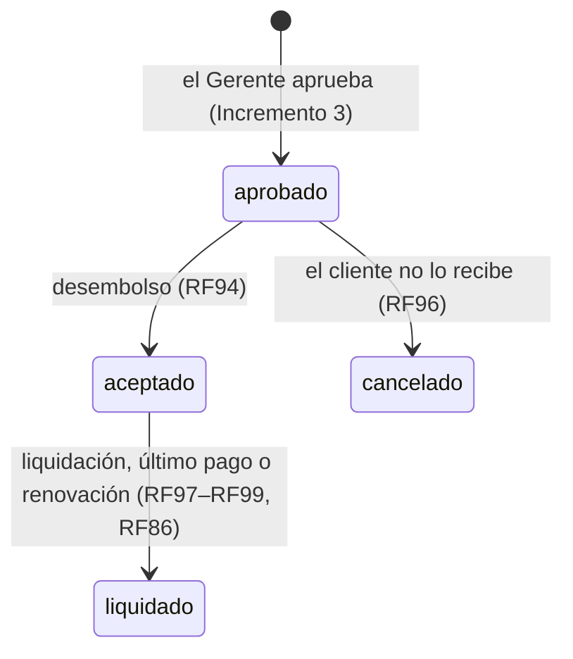

# 5.1 Desembolso, liquidaciones, renovaciones y comprobantes

**Incremento 5:** Renovaciones y liquidaciones
**Responsable:** Sánchez Jimenes Jaret Isai
**Basado en:** [3.1 Solicitudes y aprobación](../incremento-3/3.1-solicitudes-y-aprobacion.md) y [4.1 Pagos y morosidad](../incremento-4/4.1-pagos-y-morosidad.md)
**Requisitos:** RF57, RF60, RF82–RF89, RF94, RF96–RF103, RF113, RF114, RNF28

Cubre las tareas 5 a 5.5: liquidación, renovación, actualización de estados (desembolso y
cancelación), comprobantes, historial de liquidaciones y reporte de renovaciones.

## 1. Estados del crédito

En pantalla, "aceptado" se muestra como **Vigente**.

## 2. Reglas de negocio

| ID | Regla |
| --- | --- |
| RN-50 | **Desembolso** (RF94): solo créditos aprobados; la fecha no puede ser futura. Si se entrega en otra fecha que la planeada, el calendario se recorre: la semana 1 vence 7 días después de la entrega real. |
| RN-51 | **Cancelación** (RF96): un crédito aprobado que el cliente no recibió se cancela con motivo. |
| RN-52 | **Liquidación** (RF97–RF99): el cliente paga todo lo que debe (saldo y mora pendiente). Es **anticipada** si ocurre antes del vencimiento de la última semana y **normal** en otro caso. También se liquida cuando un pago deja el saldo en cero. |
| RN-53 | **Renovación** (RF82–RF85): con un crédito vigente, el cliente puede pedir uno nuevo cuando ya pagó las semanas que pide su modelo (`semanas_para_renovar`, 4 por defecto). La solicitud queda marcada como renovación del crédito vigente. |
| RN-54 | Al aprobar una renovación, el monto debe ser mayor que el saldo del crédito anterior (RF86). |
| RN-55 | **Desembolso de una renovación** (RF86, RF87): en una sola transacción se liquida el crédito anterior con parte del monto nuevo (saldo y mora del momento) y se desembolsa el nuevo; el cliente recibe la diferencia. Si el crédito anterior ya no está vigente (por ejemplo, se liquidó aparte), no se guarda nada y hay que cancelar la renovación. |
| RN-56 | **Comprobantes** (RF100, RF102, RF114, RNF28): cada operación (desembolso, pago, abono, liquidación) tiene un comprobante con folio, que se imprime o se guarda como PDF desde el navegador. Al imprimir se ocultan el menú y los botones. El de una renovación muestra cuánto se descontó para liquidar el crédito anterior y cuánto recibió el cliente. |

### Cómo se garantiza que la renovación no quede a medias

Las dos operaciones van en el mismo `db.batch()`. La liquidación del crédito anterior solo se inserta
si el crédito nuevo sigue aprobado, y el desembolso del nuevo solo si la liquidación se guardó. Las
claves de idempotencia se relacionan (`<clave>` y `<clave>:renovacion`): un reintento muestra el mismo
comprobante, y cada comprobante encuentra a su pareja.

**Acciones nuevas en la bitácora:** `credito_desembolsado`, `credito_cancelado`, `credito_liquidado`.

## 3. Pantallas

| Tarea | Pantalla | Qué hace |
| --- | --- | --- |
| 5.2 Estados | **Crédito** (`/creditos/:id`) | Botones según el estado: Registrar desembolso y Cancelar (aprobado); Registrar pago, Liquidar y Condonar mora (vigente). Avisos de renovación en curso y de crédito liquidado. |
| 5.1 Renovación | **Ficha del cliente** → "Renovar crédito" | Aparece cuando el crédito vigente ya puede renovarse; si no, la solicitud explica cuántas semanas faltan. |
| 5.3 Comprobantes | **Comprobante** (`/comprobantes/:id`) | Se abre al guardar cada operación y desde la tabla de operaciones y los reportes. |
| 5.4 Historial de liquidaciones | **Reportes → Liquidaciones** | Créditos liquidados en el periodo: normal, anticipada o por renovación, con enlace al comprobante. |
| 5.5 Reporte de renovaciones | **Reportes → Renovaciones** | Crédito anterior, crédito nuevo, estado, monto descontado y monto entregado. |

Todos los reportes se descargan en CSV.

## 4. API

| Método | Ruta | Quién | Descripción |
| --- | --- | --- | --- |
| POST | `/api/creditos/:id/desembolso` | Gerente, Cobrador | Desembolso (y liquidación del anterior si es renovación) |
| POST | `/api/creditos/:id/cancelar` | Gerente, Cobrador | Cancela un crédito aprobado |
| POST | `/api/creditos/:id/liquidacion` | Gerente, Cobrador | Liquida saldo y mora |
| GET | `/api/operaciones/:id` | Todos (según su ámbito) | Datos del comprobante |
| GET | `/api/reportes/liquidaciones?desde=&hasta=` | Todos | Historial de liquidaciones |
| GET | `/api/reportes/renovaciones?desde=&hasta=` | Todos | Reporte de renovaciones |

## 5. Pendiente

- Corrección de operaciones (RF72): la tabla ya la admite (`operacion_corregida_id`), falta la pantalla.
- Asignación de modelos por Cobrador (RF27) y documentos con evidencia del desembolso (RF17–RF23).

Las pruebas están en [5.6 Pruebas del módulo](5.6-pruebas-del-modulo.md).
